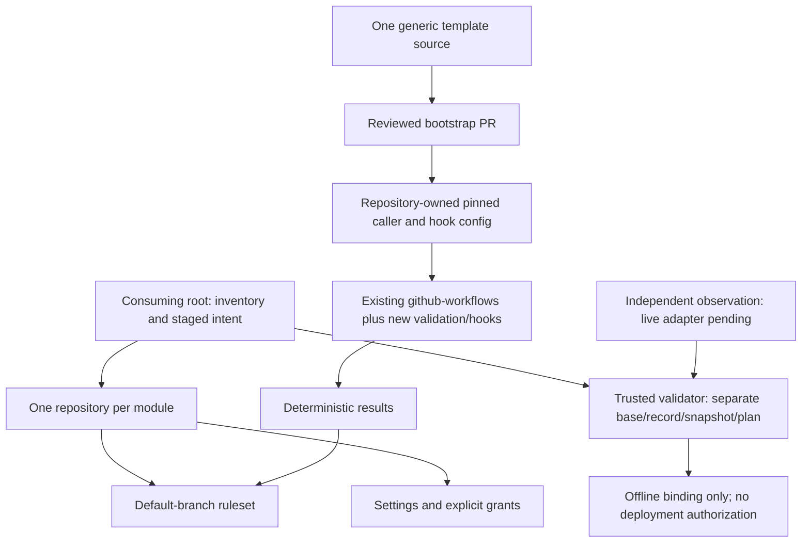

# Local v1 architecture

No organization policy is managed by this module. No workflow executes Terraform
from the trusted policy job. Candidate Terraform validation is unprivileged and
separate from credentialed infrastructure planning. The deployment workflow now connects isolated policy gates but blocks live
repository authorization. No backend, credential, record writer, live collector, or active
caller is created by this local implementation.

Functional increments: core/adoption; optional access/actions/rules; root staging;
generic template and Go pilot; trusted policy fixtures/bindings; documentation and
workflow linting. See verification.md for actual pass/blocked results, not inferred
operational readiness.
